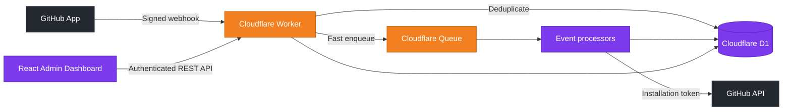

<div align="center">


# 🤖 EliteGitBot

### Secure GitHub automation, running at the edge

Monitor repositories, review pull requests, triage issues, track workflows, and manage automation from one self-hosted dashboard.

[](https://www.typescriptlang.org/)
[](https://workers.cloudflare.com/)
[](https://react.dev/)
[](https://hono.dev/)

[](https://github.com/kamrullab/EliteGitBot/actions/workflows/security-analysis.yml)
[](https://github.com/kamrullab/EliteGitBot/actions/workflows/ci.yml)
[](LICENSE)
[](https://nodejs.org/)
[](https://developers.cloudflare.com/d1/)
[](#analysis-providers)
[](#analysis-providers)

[Features](#features) · [Architecture](#architecture) · [Quick start](#quick-start) · [Deployment](#deployment) · [Roadmap](#roadmap)

</div>

---

EliteGitBot is a self-hosted GitHub App for secure webhook processing, repository monitoring, deterministic pull-request review, issue triage, workflow tracking, and an authenticated administration dashboard. Its core mode uses no paid AI service.

> [!IMPORTANT]
> EliteGitBot is a functional automation platform, not a mock dashboard. Core analysis works without sending source code to a paid AI provider.

<a id="features"></a>
## 🚦 Feature status

| Area | Capability | Status |
|---|---|:---:|
| 🔗 GitHub App | JWT authentication and short-lived installation tokens | ✅ Ready |
| 🪝 Webhooks | HMAC verification, deduplication, Queue processing | ✅ Ready |
| 📦 Repositories | Installation sync and repository controls | ✅ Ready |
| 🔍 Pull requests | SHA-aware reviews, findings, GitHub comments | ✅ Ready |
| 🧭 Issues | Classification and transparent automated replies | ✅ Ready |
| ⚙️ Workflows | GitHub Actions status and failure tracking | ✅ Ready |
| 🛡️ Security | Secret redaction, Semgrep, and Trivy | ✅ Ready |
| 📊 Dashboard | Live D1 statistics and responsive light/dark UI | ✅ Ready |
| 🧠 AI providers | Gemini and any OpenAI-compatible API with safe fallback | ✅ Ready |

## What is implemented

- GitHub App JWT authentication and short-lived installation tokens (never persisted).
- HMAC-SHA256 webhook verification, fixed-size timing-safe comparison, D1 delivery deduplication, and Queue processing with retries/DLQ.
- Installation/repository synchronization, per-repository automation controls, PR SHA deduplication, issue classification/replies, workflow-run persistence, activity logs, and real dashboard statistics.
- Local rule-based security review with secret redaction; no PR code is executed in Workers. Semgrep and Trivy run in a least-privilege GitHub Actions workflow.
- Single-admin PBKDF2 password verification, HttpOnly sessions, strict same-site cookies, CSRF double-submit validation, expiry, logout, protected routes, and login throttling.
- Responsive light/dark React dashboard using Vite, Tailwind, TanStack Query, React Router, Lucide, and accessible loading/error/empty states.
- D1 migrations, strict TypeScript, Worker and UI tests, observability, example secrets, and deployment configuration.

<a id="architecture"></a>
## 🏗️ Architecture



<details>
<summary><strong>Plain-text architecture</strong></summary>

<br>

```text
GitHub App -> signed webhook -> Worker -> D1 delivery ledger -> Queue
                                                    |          |
React dashboard <- authenticated REST API <- D1 <---+----------+
                                                               |
                                      GitHub API <- event processors
```

</details>

Queues provide at-least-once delivery; database uniqueness makes processing idempotent. Failed messages retry three times and then enter `elite-gitbot-events-dlq` for recovery.

## 🧰 Technology stack

| Layer | Technologies |
|---|---|
| Dashboard | React, Vite, TypeScript, Tailwind CSS, TanStack Query, React Router, Lucide |
| API | Cloudflare Workers, Hono, Zod |
| Persistence | Cloudflare D1 |
| Background jobs | Cloudflare Queues and dead-letter queue |
| GitHub integration | GitHub App authentication and REST API |
| Security analysis | Local rules, Semgrep, Trivy |
| Testing | Vitest, Testing Library |

<a id="quick-start"></a>
## ⚡ Quick start

### Prerequisites

- Node.js 20+
- A Cloudflare account with Workers, D1, and Queues enabled
- A GitHub App

### Install and configure

```bash
npm install
cp .dev.vars.example apps/worker/.dev.vars
npm run cf-typegen
npx wrangler d1 migrations apply elite-gitbot --local --config apps/worker/wrangler.jsonc
npm run dev
npm run dev:web
```

### Docker alternative

After creating `apps/worker/.dev.vars`:

```bash
docker compose up --build
```

The dashboard is available at `http://localhost:5173` and the Worker at `http://localhost:8787`.

Create an admin password hash without sending the password anywhere:

```bash
node scripts/hash-password.mjs "your-password"
```

Store the output as `ADMIN_PASSWORD_HASH`. Do not put production secrets in `.dev.vars` or source control.

## 🔌 GitHub App configuration

Set the webhook URL to `https://YOUR_WORKER/api/webhooks/github`, choose a random webhook secret, and subscribe to `pull_request`, `pull_request_review`, `pull_request_review_comment`, `issues`, `issue_comment`, `push`, `release`, `workflow_run`, `check_suite`, `installation`, `installation_repositories`, and `repository`. GitHub may not offer `security_advisory` for every personal App configuration.

Minimum repository permissions:

- Metadata: Read
- Contents: Read
- Pull requests: Read and write
- Issues: Read and write
- Actions: Read
- Checks and commit statuses: Read
- Security events: Read only when the account supports it

Install the App only on repositories that should be monitored. EliteGitBot cannot access uninstalled repositories.

## 🔐 Environment variables and secrets

| Name | Required | Purpose |
|---|---:|---|
| `GITHUB_APP_ID` | yes | GitHub App identifier |
| `GITHUB_PRIVATE_KEY` | yes | PKCS#8 App private key, with escaped newlines allowed |
| `GITHUB_WEBHOOK_SECRET` | yes | webhook HMAC secret |
| `ADMIN_USERNAME` | yes | single administrator name |
| `ADMIN_PASSWORD_HASH` | yes | `pbkdf2$iterations$salt$hash` value |
| `SESSION_SECRET` | yes | at least 32 random bytes |
| `GEMINI_API_KEY`, `GEMINI_MODEL` | no | reserved external provider configuration |
| `OLLAMA_BASE_URL`, `OLLAMA_MODEL` | no | reserved trusted Ollama endpoint configuration |
| `AI_ENABLED` | no | enables the selected external provider when `true` |
| `AI_PROVIDER` | no | `rule-based`, `gemini`, or `openai-compatible` |
| `AI_API_KEY` | no | secret for an OpenAI-compatible provider |
| `AI_BASE_URL` | no | provider API base URL, such as OpenRouter `/api/v1` |
| `AI_MODEL` | no | provider-specific model identifier |
| `AI_ALLOWED_HOSTS` | no | comma-separated SSRF protection allowlist |
| `AI_PRIVATE_REPOSITORIES_ENABLED` | no | explicit opt-in for transmitting private-repository content |

Production secrets are uploaded interactively:

> [!CAUTION]
> Never commit `.dev.vars`, API keys, GitHub private keys, webhook secrets, or production credentials.

```bash
npx wrangler secret put GITHUB_APP_ID --config apps/worker/wrangler.jsonc
npx wrangler secret put GITHUB_PRIVATE_KEY --config apps/worker/wrangler.jsonc
npx wrangler secret put GITHUB_WEBHOOK_SECRET --config apps/worker/wrangler.jsonc
npx wrangler secret put ADMIN_USERNAME --config apps/worker/wrangler.jsonc
npx wrangler secret put ADMIN_PASSWORD_HASH --config apps/worker/wrangler.jsonc
npx wrangler secret put SESSION_SECRET --config apps/worker/wrangler.jsonc
```

<a id="deployment"></a>
## ☁️ Provision and deploy

Replace the D1 database ID in `apps/worker/wrangler.jsonc`, then:

```bash
npx wrangler d1 create elite-gitbot
npx wrangler queues create elite-gitbot-events
npx wrangler queues create elite-gitbot-events-dlq
npx wrangler d1 migrations apply elite-gitbot --remote --config apps/worker/wrangler.jsonc
npm test
npm run build
npm run deploy
```

## 🧪 Tests and quality checks

`npm test` runs cryptographic signature, rule analysis/redaction, issue classification, and login UI tests without real GitHub credentials. `npm run typecheck` verifies both applications. `npm run build` performs a dashboard production build and Worker dry-run bundle.

| Command | Purpose |
|---|---|
| `npm run lint` | ESLint checks for Worker code |
| `npm run typecheck` | Strict TypeScript verification for both applications |
| `npm test` | Cryptography, analyzer, classification, and UI tests |
| `npm run build` | Dashboard build and Worker dry-run bundle |

<a id="analysis-providers"></a>
## 🧠 Analysis providers

| Provider | Cost requirement | Source-code privacy | Availability |
|---|---|---|---|
| Rule-based | None | Remains inside the Worker | ✅ Default |
| Google Gemini | Provider-dependent | Requires explicit private-code consent | ✅ Supported |
| OpenRouter | Free/paid models | Requires explicit private-code consent | ✅ Supported |
| OpenAI-compatible APIs | Provider-dependent | HTTPS endpoint must be allowlisted | ✅ Supported |
| Ollama | Self-hosted infrastructure | Must expose a trusted HTTPS OpenAI-compatible endpoint | ✅ Supported |

The deterministic provider detects suspicious credentials, injection patterns, risky HTML sinks, and unsafe logging. Findings are heuristic warnings and never claim that code is secure.

## 🗂️ Project structure

```text
EliteGitBot/
├── apps/
│   ├── web/                 # React administration dashboard
│   └── worker/              # Hono API and Queue consumer
│       ├── src/ai/          # Providers and deterministic rules
│       ├── src/github/      # GitHub App and API client
│       ├── src/services/    # Authentication and event processing
│       └── tests/           # Worker tests
├── migrations/              # Versioned D1 schema
├── scripts/                 # Administration utilities
├── docs/                    # Engineering documentation
└── .github/workflows/       # Isolated security analysis
```

<a id="roadmap"></a>
## 🗺️ Roadmap

- [x] Complete Gemini and OpenAI-compatible provider execution
- [x] Add secret-based provider settings and SSRF allowlisting
- [ ] Publish and manage GitHub labels
- [ ] Add manual review and issue-reply approval queues
- [ ] Ingest Semgrep and Trivy SARIF findings into D1
- [ ] Support pagination beyond 100 changed files
- [ ] Add repository activity charts and trend analytics
- [ ] Add email, Slack, and Discord notifications
- [ ] Add multi-administrator roles and audit exports
- [ ] Add multi-tenant GitHub installations for SaaS mode

## 🛡️ Safety and limitations

- EliteGitBot never automatically approves, merges, closes, deletes branches, or executes PR code.
- Inline comments are intentionally not emitted by the current deterministic analyzer because patch positions are not yet mapped to GitHub diff coordinates. Findings are published as general review comments, avoiding invented line numbers.
- Rule matching is heuristic and cannot prove code secure. Semgrep/Trivy results currently remain in GitHub SARIF; ingestion into D1 is a future enhancement.
- The implementation analyzes the first 100 changed files. Very large PR pagination is a follow-up.
- External providers use timeouts, schema validation, secret redaction, host allowlisting, and rule-based fallback; provider quotas still depend on the selected service.
- Queue availability and quotas vary by current Cloudflare plan. If unavailable, replace the producer with a separately deployed Worker/service binding; do not run long AI work synchronously in the webhook.
- GitHub Discussions do not provide equivalent webhook support for every GitHub App/account combination.

## 🤝 Contributing

Issues and pull requests are welcome. Before submitting a change:

1. Keep credentials and private repository content out of fixtures.
2. Preserve the no-auto-merge and no-auto-approval defaults.
3. Run `npm run lint`, `npm run typecheck`, and `npm test`.
4. Document security-sensitive behavior and include tests.

## 📚 Documentation

- [Architecture](docs/ARCHITECTURE.md)
- [REST API overview](docs/API.md)
- [AI provider configuration](docs/AI_PROVIDERS.md)
- [Deployment guide](docs/DEPLOYMENT.md)
- [Demo and screenshot policy](docs/DEMO.md)
- [Implementation plan](docs/IMPLEMENTATION_PLAN.md)
- [Example local configuration](.dev.vars.example)
- [D1 schema](migrations/0001_initial.sql)
- [Worker configuration](apps/worker/wrangler.jsonc)
- [Contributing guide](CONTRIBUTING.md)
- [Security policy](SECURITY.md)
- [Changelog](CHANGELOG.md)

---

<div align="center">

Built with ☁️ Cloudflare, 🐙 GitHub, and strict TypeScript.

**If EliteGitBot is useful, consider starring the repository.**

</div>
